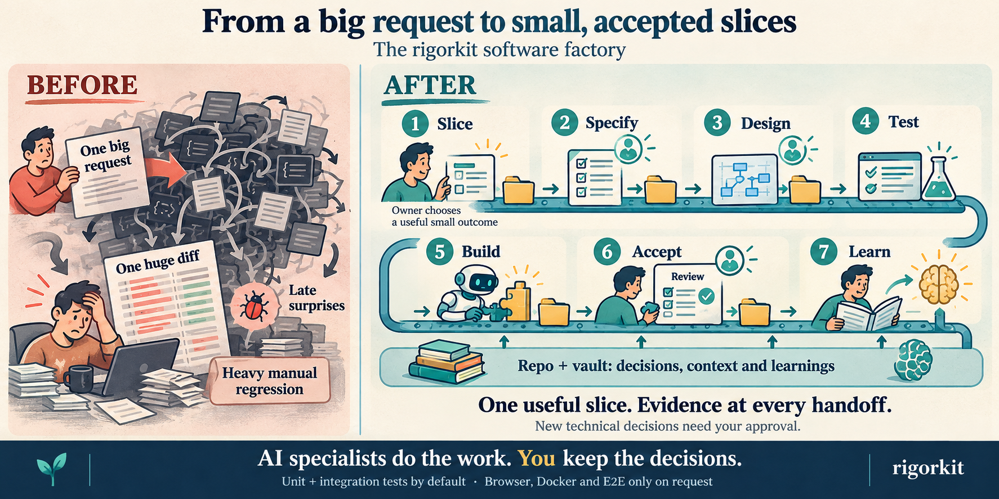

# rigorkit
An AI software factory for rigorous, tool-neutral work: lanes of work, each staffed by specialists, with human approval gates and explicit Definition of Done. Supports Claude Code, Codex, Cursor and OpenCode. Install only the packs you need. Current version: 0.1.0 (`VERSION`, `./install.sh --version`).

## From a feature to an accepted slice



The factory coordinates the work; **Spec-Driven Development (SDD) remains the method inside each slice**. A slice is the smallest useful behavior that works across its required layers and repositories. A user story or ticket describes that slice; technical tasks are its internal checklist, not separate deliveries.

| Station | Output and handoff |
|---|---|
| 1. Slice the feature | Propose a flat backlog of useful outcomes and dependencies. You choose the next slice. |
| 2. Specify and clarify | Agree on behavior, acceptance, scenarios, invariants and exclusions. You approve WHAT. |
| 3. Design and plan | Propose the minimum solution and its tasks. You approve new technical decisions and HOW. |
| 4. Prepare tests | Turn acceptance into checks that can distinguish the requested behavior from a plausible wrong implementation. |
| 5. Build | Implement the approved slice, run permitted tests and return evidence. No speculative behavior. |
| 6. Review and accept | Check spec compliance separately from architecture and applicable specialist concerns. You accept this slice. |
| 7. Close and learn | Record completion, update repository knowledge and propose reusable learnings. You choose what comes next. |

Each handoff carries the approved scope, relevant decisions and sources, affected consumers, evidence and unresolved items. A station cannot treat the previous agent's claim as proof. Implementation defects return to construction; ambiguous behavior returns to you. Acceptance never silently starts another slice or authorizes a commit, push or merge.

### The brain accompanies every station
The adopting repository is the source of truth. When configured, the vault is the shared brain for reusable decisions and knowledge, available whenever a station needs it. Search by topic, read the relevant notes and reuse unchanged evidence; do not load the whole vault at every step. Before applying an existing decision, report the decision and its source. Ask about conflicts or uncertain applicability; every new technical decision requires your approval.

Repository-specific findings stay in that repository. Generic team learnings live in `specs/learnings/`; cross-project knowledge is proposed for the vault and promoted only with approval. Later slices consult those lessons instead of starting from scratch.

### Small means useful, not incomplete
For instance-level form options, a useful first slice is: configure the clear button on a widget instance, preserve it through the existing data path, render that choice, and prove that two instances of the same form can differ. A CMS section can be a separate slice when it is independently usable. "Add a backend field" alone is a task, not a user outcome.

```json
{
  "widgetA": { "formId": "contact", "showClearButton": true },
  "widgetB": { "formId": "contact", "showClearButton": false }
}
```

Keep only the behavior and constraints agreed for this slice. Missing information becomes a question, not a guessed default, future option or new abstraction. See the [worked example and Jest checks](packs/sdd/examples.md).

### Execution boundary
Agents may run existing, scoped unit and integration tests with Jest or equivalent tools. Browser sessions, Docker and end-to-end tests require an explicit request. Installation, build, lint, typecheck, migrations, seeds and deployment are not authorized by this testing permission. If a test requires unavailable services or restricted infrastructure, report it as pending; do not start the infrastructure. Stricter adopting-project rules still apply.

Local skills/agents now carry this contract; setup includes frozen-test and lexical branch-trace checks. See the [execution and evidence details](packs/sdd/README.md#implemented-factory-checks) and [agency-agents adaptations](packs/sdd/agency-adaptations.md). Owner acceptance, the ratchet-member decision and a real adoption run remain pending. Existing installed copies are unchanged; reviewer defaults require an explicit owner profile decision.

## Lanes and packs
A **lane** is a track of work with an entry, its specialists, its output and its exit criterion. A **pack** is the set of specialists staffed in a lane and stays their namespace: every member is named `<pack>-<role>`. A pack can also be specialists called from another lane, and the core pack carries global rules instead of a lane.

| Lane | Specialists | Entry | Output | Exit |
|---|---|---|---|---|
| SDD (core) | `sdd` pack | A change to specify | Approved spec, plan, functional blocks, reviewed diff | The owner closes the change |
| design | `design` pack | A change with rendered screens | UX criteria, UI criteria, interface verdict | Defects corrected or registered |
| security | `security` pack | A change with sensitive paths or a new data flow | Threat model, secure defaults, security verdict | Findings fixed or escalated |
| operation | deferred to a later change | — | — | — |

`architecture` and `frontend` are specialists the SDD lane calls in its review station; `core` provides global token-economy rules for every session.

| Pack | Contents |
|---|---|
| [core](packs/core/README.md) | Global token-economy rules and test/error/JSON summary helpers; --global only |
| [sdd](packs/sdd/README.md) | Reviewed specs, joint plan/block approval, functional-block delivery and selective context; templates, checks, three readonly agents and a builder |
| [architecture](packs/architecture/README.md) | Layers/hexagonal, plugin registry, architecture review/audit |
| [frontend](packs/frontend/README.md) | React/Next.js folders/names/routes/barrels, frontend review/audit |
| [design](packs/design/README.md) | UX flow and UI criteria, accessibility level, capture checklist and advisory interface review |
| [security](packs/security/README.md) | Threat modeling and secure defaults, security review of designs and diffs |

## Install
```bash
git clone <repository-url> rigorkit
cd rigorkit
./install.sh --version
./install.sh --list
./install.sh --pack sdd --agent claude,cursor --project ~/code/my-repo
./install.sh --pack sdd --agent claude,codex,cursor,opencode --global
./install.sh --pack all --agent claude,cursor --project ~/code/my-repo --force
./install.sh --pack core --agent claude,codex,opencode --global --dry-run
```
| Option | Meaning |
|---|---|
| --pack sdd[,other] | Select packs; all cannot be combined with names |
| --agent claude,codex,cursor,opencode | Target tools |
| --project DIR | Install into repository; default current directory |
| --global | User-wide installation |
| --force | Overwrite existing installed files |
| --dry-run | Show planned actions, rule diff; no writes |
| --version | Print the local version |
| --uninstall-rules | Remove only rigorkit global rule blocks |
Update with git pull, then reinstall --force. --pack all --force replaces installed packs and adds new ones.

The version lives in `VERSION` at the repository root and is the only copy of it. The installer records the version it wrote in `.rigorkit-version` at the scope root (the project directory, or your home directory for a global install), and `--list` prints the local version next to the installed one. Without `--force` the installer never overwrites an installed copy, so a different installed version is reported instead of replaced.

## Destinations
| Tool | Skills | Agents |
|---|---|---|
| Claude Code | .claude/skills/ | .claude/agents/*.md |
| Codex | .agents/skills/ | .codex/agents/*.toml |
| Cursor | .agents/skills/ | .cursor/agents/*.md; reads .claude/agents/ if Claude also selected |
| OpenCode | .agents/skills/ | .opencode/agents/*.md; global ~/.config/opencode/agents/ |
Global paths start at ~. Skills are copied, not symlinked (unreliable in Cursor/Codex); .rigorkit records origin and .rigorkit-version records the installed version. Cursor/OpenCode may see duplicate skills when .claude/skills and .agents/skills coexist.
Global core rules use markers in ~/.claude/CLAUDE.md, ~/.codex/AGENTS.md and ~/.config/opencode/AGENTS.md, preserving outside content; see [core](packs/core/README.md).

## Optional model tiers
Agents declare cheap/strong, never a fixed model. Configure per tool in ~/.config/rigorkit/models and reinstall --force:
```
claude.cheap=haiku
claude.strong=opus
opencode.cheap=<provider/model>
```
Legacy barato/fuerte tiers and keys still work; English keys take precedence, even when empty (inherit session). Missing file/tool mapping also inherits session; one-model/free-model setups need none. Override path with RIGORKIT_MODELS.

## SDD and the other lanes
Install `sdd`, then ask for `sdd-init`. For existing code, continue with `sdd-adopt`. `sdd` is the core lane; `design` and `security` staff their own lanes and join the SDD review station when the change needs them.

Change flow (the entry stage is being added in the Factory v2 work):

1. `sdd-slice` → owner-selected backlog entry → `sdd-triage` / `sdd-context`
2. `sdd-spec` → `sdd-clarify` automatically; user approves the clarified spec
3. `sdd-plan` → `sdd-tasks` automatically; user approves the plan and functional blocks
4. `sdd-tests` for the selected slice/block; run permitted tests and record intended-red evidence
5. `sdd-implement` (the approved slice/block; internal tasks, minimum implementation, scoped unit/integration tests)
6. `sdd-verify` (spec/architecture/integration evidence; requested live checks, otherwise pending)
7. `sdd-archive`

After the builder, the enabled reviewers run together, each with the same references and no other reviewer's report. `sdd-approver` aggregates their verdicts into approved, needs human or failed, and you close the change. Interface improvements never block; an interface defect blocks only when the same change does not correct it.

You approve WHAT after the spec has been clarified, then HOW after the plan and block tasks are ready. Unresolved decisions come back to you before proceeding. Internal tasks are a checklist: implementation and review cover the approved functional block, with scoped unit/integration checks and explicit approval for every commit. Tests outside that boundary remain on request; every slice is accepted separately.

Reuse verified context while its source is unchanged; read referenced sections and expand when evidence is missing, dependencies change or risk grows. Whole-change integration and critical-path checks remain required; required live verification stays pending until explicitly requested and evidenced. See [functional blocks](packs/sdd/README.md#functional-blocks), [review stations](packs/sdd/README.md#review-stations) and [selective context](packs/sdd/README.md#selective-context-global-verification).


Process skills have roles/stops; paired SDD stages share their approval gate. Reference skills (`architecture-boundaries`, `frontend-structure`, `design-ux-flow`, `design-ui-criteria`, `security-baselines`) supply knowledge and follow their caller's stop. Readonly reviewers inspect diffs or audit folder debt. Cross-pack dependencies are soft, by name: absent packs are reported and SDD performs relevant checks itself. Implementation/verification uses the architecture reviewer and the frontend reviewer for .tsx/.jsx/app/ changes, plus the security reviewer for sensitive paths and the interface reviewer for rendered screens.

Ask for "audita la arquitectura de src/" or "audita la estructura del front". Contribution rules: [AGENTS.md](AGENTS.md).

## Website
The intended GitHub Pages address is [harrypotter48.github.io/rigorkit](https://harrypotter48.github.io/rigorkit/). Publication requires enabling Pages and a successful primary-branch workflow; configuration alone does not mean the site is live.
The website regenerates documentation, pack summaries and search from this README and pack Markdown during CI builds. A push to main publishes the checked result through GitHub Actions when Pages is configured; feature branches and PRs only run checks. Internal specs are excluded from its pages/search. See [website maintenance](site/README.md) for local setup, checks and publishing prerequisites.

## License
MIT: [LICENSE](LICENSE). Some SDD templates derive from [hello-sdd](https://github.com/mouredev/hello-sdd), Apache-2.0; see [NOTICE](packs/sdd/NOTICE.md).
